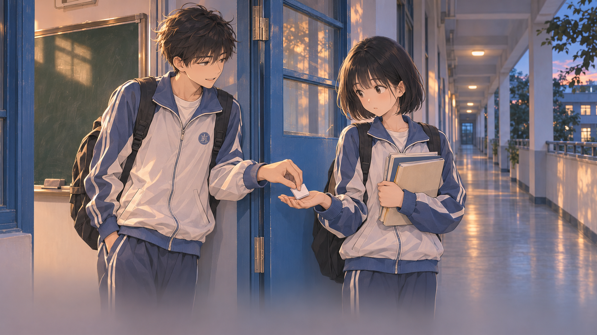

# LoveNarrativeGame · 原创 2D 叙事游戏半成品

> **这是我在学习 Unity 的过程中，使用 OpenAI Codex 辅助制作的原创校园情感叙事游戏半成品。**
> 当前是持续开发中的可运行原型，主线故事尚未全部接入，画面和交互也在继续打磨。

`LoveNarrativeGame` 是工作目录与仓库名称，正式游戏名称尚未确定。当前制作的故事暂用名为 **《旁边的位置》**，讲述凌赫与李晚云从一次换座开始，在日常相处、互相帮助与人生选择中逐渐靠近的经历。

我希望玩家通过一些细小的动作感受人物的情绪：在练习本上找一条小路、把地上的水擦干、决定怎样递还一张卡、和对方一起算一道题，以及把一句没有直说的话折进纸条里。



*开发中的故事插画；画面、人物细节与正式呈现仍可能调整。*

## 我与 Codex 怎样完成这个项目

- **我负责**原始故事创作、人物与情绪方向、玩法和美术取舍、素材提供与修改，以及实际试玩和反馈。
- **Codex 协助**把想法整理为交互设计与场景稿、辅助对白润色，编写与修改 C# 和界面逻辑，接入资源、排查问题、执行编译和构建，并记录开发过程。
- 部分插画使用 AI 工具辅助生成，再根据我的反馈修订；部分素材由我提供。具体来源与待确认事项记录在[素材台账](docs/ASSET_LICENSES.csv)。

这个仓库记录的是我借助 Codex 从零学习、逐步做出作品的过程。代码、设计与素材都有迭代痕迹，欢迎结合提交记录和开发文档了解实际完成的工作。

## 目前做到哪里了

**截至 2026-11-03：已接入第一至第五幕，以及第七幕，共六个可玩章节、126 段对白/旁白、29 个剧情图片映射。** 第六幕按开发安排暂缓，当前第五幕结束后直接进入标为“07”的第七幕，保留故事中的时间跨度。

| 部分 | 当前状态 |
| --- | --- |
| 游戏入口 | 插画主菜单、开始游戏、设置、退出确认 |
| 故事与章节目录 | 整部故事卡片入口、横向章节流程、依次解锁、已完成章节重看 |
| 阅读体验 | 图片切换与淡入、逐字对白、半透明对白框、暂停、连续播放 |
| 本机进度 | 自动保存阅读位置与章节完成状态，下次进入可接着读 |
| 第一幕《最后一排》 | 剧情接入；练习本上的校园寻路互动，可撤回和重画 |
| 第二幕《再等十分钟》 | 换座及两人初次交谈的图文演出 |
| 第三幕《水杯》 | 剧情接入；俯视擦水小游戏，含提醒补擦与替代操作 |
| 第四幕《你的核酸码》 | 可选择直接递还或故作从容，以不同停顿和回应表现人物 |
| 第五幕《这道题》 | 默认合作推导，计算逐步写在练习本上；自主输入答案可选 |
| 第七幕《回宿舍再看》 | 四张新图、25 段对白/旁白；折好并递出纸条，再接宿舍演出 |
| 设置与声音 | 音乐/音效音量、五档分辨率、全屏；新用户默认 1920×1080 全屏，已接循环背景音乐 |
| 语言 | 菜单提供简体中文、繁体中文、英语、日语；当前剧情正文为简体中文 |

**验证范围：** 已通过当前版本的 Unity 编译、章节/互动状态与资源检查，并生成 Windows 开发构建；部分界面做过静态排版检查。最新第七幕的实际点击、暂停、重启续读与听感仍待我继续试玩验收，尚未完成完整回归和多设备测试。详细证据见[开发进度](docs/PROGRESS.md)。

## 如何打开项目

1. 克隆或下载本仓库。
2. 在 Unity Hub 中添加仓库里的 **`UnityProject/`** 文件夹。
3. 使用 **Unity 6.6 / 6000.6.7f1** 打开，等待资源与包导入完成。版本以 [ProjectVersion.txt](UnityProject/ProjectSettings/ProjectVersion.txt) 为准，依赖以 [manifest.json](UnityProject/Packages/manifest.json) 和锁文件为准。
4. 在 Unity 顶部菜单选择 **Tools → Story Prototype → Open Main Menu**，然后点击 Play。
5. 从“开始游戏”进入《旁边的位置》，再进入章节目录。首次只开放第一幕，完成后依次解锁。

需要生成 Windows 版本时，退出 Play，选择 **Tools → Story Prototype → Build Illustrated Menu**，输出到仓库根目录 `Builds/MenuDemo/`。构建目录不纳入 Git；本仓库当前提供工程源码和开发资源，没有随仓库附带可下载的正式发行包。

实际试玩步骤可参考[章节与续读](docs/CHAPTER_READING.md)、[第一幕寻路](docs/FIRST_ACT_ROUTE.md)、[第三幕擦水](docs/THIRD_ACT_MOP_TOPDOWN.md)、[第四/五幕互动](docs/ACTS_4_5_PRESENTATION.md)、[第七幕](docs/SEVENTH_ACT.md)。

## 技术与目录

采用 **C#、Unity 2D / URP、UGUI、TextMeshPro、Input System**。剧情通过 ScriptableObject 配置，小型状态机管理互动条件，本机保存章节与阅读书签。游戏运行不依赖在线生成式 AI 服务。

```text
UnityProject/
  Assets/_Game/Scripts/      阅读、菜单、进度与互动逻辑
  Assets/_Game/Editor/       内容安装、资源检查与构建工具
  Assets/_Game/Resources/    剧情配置、图片、字体引用与音频
  Packages/                 Unity 包清单与锁文件
  ProjectSettings/          工程配置
art/                        插画原稿、部分生成提示与美术迭代
docs/                      设计、进度、验收与素材来源说明
```

关键入口：[StoryScreen](UnityProject/Assets/_Game/Scripts/StoryScreen.cs) 组织阅读与章节，[StoryReadingState](UnityProject/Assets/_Game/Scripts/StoryReadingState.cs) 管理解锁/书签，各互动拆成相应的状态与表现脚本。当前结构以完成短篇原型和便于学习为目标，后续会随实际需要整理。

## 接下来期待什么

- 补回第六幕，并继续完成后续主线，把整段故事演绎连贯。
- 让互动与画面更自然地连接，继续打磨节奏、动作反馈和人物情绪，减少“离开故事去做小游戏”的感觉。
- 统一人物、教室空间和美术质量，替换或完善临时素材。
- 完善音效、环境声和音乐衔接，再根据制作能力决定是否加入角色配音。
- 继续评估具有不同理解价值的二周目体验；目前尚未制作完整双周目。
- 补齐正式翻译、存档升级与兼容性测试，逐步达到可公开试玩的质量。
- 长期目标是完成一款原创、短篇、买断制、离线的纯 2D 叙事游戏，优先面向 Windows，未来争取在 Steam 发行。移动端放在 Windows 版本稳定之后评估。

这些是开发愿望与方向，目前没有承诺发售日期、售价或最终规模。

## 素材与使用说明

仓库中有原创故事与代码、作者提供素材、AI 辅助插画、字体及 Unity 模板/包资源，来源与适用条件各不相同。项目目前**未统一授予开源许可证**；公开展示或可查看源码不等于全部素材可自由复用或商业使用。字体附带的许可文件予以保留，背景音乐与部分图像参考的发行授权仍待核实，详见[素材台账](docs/ASSET_LICENSES.csv)。

## 开发记录

- [进度与验证证据](docs/PROGRESS.md)
- [路线图](docs/ROADMAP.md)
- [当前主线互动设计](docs/INTERACTION_MAINLINE_V0.4.md)
- [完整主线剧情稿（含剧透）](docs/MAIN_STORY_V0.3.md)
- [README 历史开发记录](docs/README_HISTORY.md)

我希望这个项目最终能成为一部让人记住人物与情绪的作品，也能真实记录：一个初学者如何借助 Codex，把自己写下的故事一点点做成可以亲手体验的游戏。
