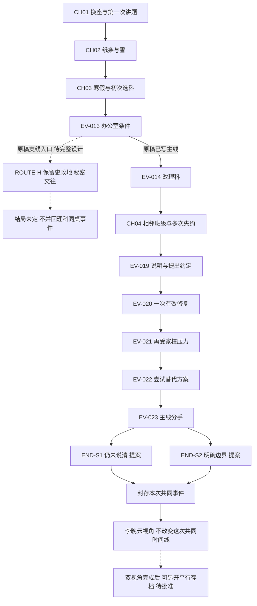

# 校园故事：整体叙事结构 v0.1

2026-10-30 · 结构提案，非正式剧本。原设与补充标记沿用[故事分析](STORY_ANALYSIS_V0.1.md)。具体交互见[互动设计](INTERACTION_DESIGN_V0.1.md)。

【原设】主线为凌赫改选理科、两人最终分手。【提案】本版先围绕该主线建立一周目和对应女主视角；作者已有“假分手、继续秘密交往”入口保留，不把未写完的路线擅自补成确定结局。

## 1. 章节与场景

编号规则：CH 为章节；A 为凌赫视角场景，B 为李晚云视角场景；EV 为双方世界中发生的稳定事件；IN 为交互。场景 ID 是叙事段落，不代表必须建一个 Unity .unity 文件。多个桌面段落可共用一个表现模板。

以下章节标题、节奏预算、交互安排皆为提案。男主线约 50–70 分钟、女主线约 25–40 分钟是控制设计密度的初始目标，不是已计时内容、售价依据或发行承诺；试玩后应缩减无效停顿。

| 章节 / 工作名 | 情绪任务 | 核心意象 | 目标时长 |
| --- | --- | --- | --- |
| CH01 旁边的位置 | 让玩家喜欢具体的相处，而不是接受“他们相爱了”的通知 | 直角课桌与共同纸面 | 12–16 分钟 |
| CH02 没有说破 | 从互助到主动的亲近 | 纸条与第一张合照 | 8–12 分钟 |
| CH03 写下去的方向 | 看见感情之外的兴趣、自主与家长压力 | 聊天窗口与选科表 | 12–16 分钟 |
| CH04 同一声铃 | 从自然相见到需要维护的相见 | 走廊与习题纸 | 12–16 分钟 |
| CH05 各自的一页 | 尝试之后承认限制，保留过去的价值 | 书页与归还的时间 | 6–10 分钟 |

### CH01：旁边的位置

| 场景 ID | 时地 / 事件 | 剧情目的与可见信息 | 玩家行为及流向 |
| --- | --- | --- | --- |
| A-010 | 高一，午前数学课；聊天被抓，EV-001 | 【原设】后排、鸡排饭、朋友、老师；先建立轻快日常 | 聊天演出；搬书到新座位 IN-01 → A-011。不能靠点击快避开换座 |
| A-011 | 同日午休，直角邻座；首次交谈 EV-002 | 【原设】李晚云等食堂人少；第一次有了具体印象 | 看自己的桌面与门口，询问午饭；留白可跳过 → A-012 |
| A-012 | 晚自习，碰倒水杯 EV-003 | 【原设】意外后补救、第一次认真看她 | 固定意外后扶杯、收拾 IN-01；不要求制造意外，也不把泼水当追求技巧 → A-013 |
| A-013 | 之后某日，教室至体育馆；迟交核酸码 EV-004 | 【原设】男主知道自己早已拿到码；她不知道 | 看见、收好码，既定耍帅演出；交到她手中 IN-02 → A-014 |
| A-014 | 当日晚自习后，求助与朋友邀请 EV-005 | 【原设】他选择留下；【提案】呈现讲题方法的差异 | IN-03 共同纸面；不考玩家数学成绩 → A-015 |
| A-015 | 讲题结束、次日食堂；请饭 EV-006 | 【原设】索要报答、约饭、聊优势学科与老师；让暧昧有生活内容 | 简短饭盘 / 话题观察，不新增完整烹饪小游戏 → A-020 |

IN-02 不开放“立刻还码”却又强行演出晚给：本主线这段明确为角色既定行为。若将来要让玩家改它，需独立分支并重写事件，不用隐藏系统抢走玩家已作的选择。

### CH02：没有说破

| 场景 ID | 时地 / 事件 | 剧情目的与可见信息 | 玩家行为及流向 |
| --- | --- | --- | --- |
| A-020 | 数日相处的短蒙太奇；互问数学、英语 | 【原设】互补不是一次英雄救美；【提案】让她也有帮他的可见行动 | 复用 IN-03 的简短换手版本，一次即可 → A-021 |
| A-021 | 晚自习结束，递化学纸条 EV-007 | 【原设】他表达但不知道宿舍反应 | 折起、递出 IN-04；不切女生宿舍、不显示她的好感数字 → A-022 |
| A-022 | 冬日下课，看雪、误伤、道歉、合照 EV-008 | 【原设】公开场合中的共同瞬间；他看见她的笑 | 固定误伤演出，靠近道歉；室友拍照；IN-04 短呈现 → A-030 |

照片可以短暂作为玩家的镜头画面，不等于凌赫拥有那张实体照片。照片实际归李晚云并贴入日记，按原稿保持；不擅自给男主复制品。

### CH03：写下去的方向

| 场景 ID | 时地 / 事件 | 剧情目的与可见信息 | 玩家行为及流向 |
| --- | --- | --- | --- |
| A-030 | 提前寒假，QQ 讨论选科 EV-009 | 【原设】兴趣、能力、就业建议、同班愿望同时存在 | 查看并组织谈话关注点 IN-05；正式发出的原设重要内容不改 → A-031 |
| A-031 | 母亲语音、联系中断 EV-010 | 【原设】他怕她被骂而不敢继续；不替她解释此刻内心 | 写到一半、收起未发草稿；暂停不会自动发送 → A-032 |
| A-032 | 开学女生宿舍楼下重逢 EV-011 | 【原设】她主动抱住他；教师看到 | 玩家可回应拥抱演出，不做反应速度测试；暂不展示老师私下动机 → A-033 |
| A-033 | 提交初次选科表 EV-012 | 【原设】两人写史政地；【待定】她的独立选科理由 | IN-06 查看兴趣和现有表格，确认填写 → A-034 |
| A-034 | 办公室条件 EV-013；主线改科 EV-014 | 【原设】照片、母亲来访、两个条件；【P05】补真实协商 | 阅读表单、询问方案、确认改科 IN-06 → A-035；原设另一入口见路线节 |
| A-035 | 告知李晚云，之后分班 EV-015 | 【原设】他告知；她与父母争吵；二、三班相邻 | 一周目呈现告知与分班；不直接展示他没在场的争吵 → A-040 |

初次填写是两人的既有决定，不伪装成任选四种科目却必然改理科。办公室主线承诺应在体验开始的说明中明确：这是沿作者已写路线经历人物；平行路线解锁策略待批准后实施。

### CH04：同一声铃

| 场景 ID | 时地 / 事件 | 剧情目的与可见信息 | 玩家行为及流向 |
| --- | --- | --- | --- |
| A-040 | 分班后若干日，课间见面 EV-016 | 【原设】确实有美好的时光；不能直接跳到坏消息 | IN-07 按约走到走廊，共同时间短但完整 → A-041 |
| A-041 | 高二，周星落成为同桌 EV-017 | 【原设】她认真学习、主动搭话；他的关系仍隐瞒 | 同一纸面模板用在新的同桌间；不显示她秘密好感值 → A-042 |
| A-042 | 数次讲题错过见面 EV-018 | 【原设】她从窗外看到熟悉的讲题情景 | 首次失约作为已写事件演出；随后可操作已错过之后如何结束题目、说明、补约 IN-07 → A-043 |
| A-043 | 【P06】两人就具体失约交谈、制订约定 EV-019 | 让需要与责任说得清，不用“她无理取闹”代替矛盾 | 确定一个能做到的联系安排；可表达暂时无法承诺 → A-044 |
| A-044 | 【P06】一次成功履约 EV-020 | 修复确实有效，给后续选择以重量 | 显示约定被实践；不安排第三人故意打断 → A-045 |
| A-045 | 恋情被揭发、双方受压 EV-021 | 【原设】再次暴露；【待定】发现者和具体限制 | 环境通道变化、各自应对；不把揭发者默认写成周星落 → A-050 |

多次失约用两次有差别的短段落加一次时间过渡即可，不做五遍同一个失败小游戏。若开放能够避免全部失约的自由操作，应另写能够继续交往的路线，不能仍假装玩家失约。

### CH05：各自的一页

| 场景 ID | 时地 / 事件 | 剧情目的与可见信息 | 玩家行为及流向 |
| --- | --- | --- | --- |
| A-050 | 【P06】商量能否减少联系、暂停或重新协商 EV-022 | 至少真正考虑两条第三路径；讨论限制、期限、双方是否接受 | IN-08 把具体承诺与现实条件对应，允许撤回尚未确认的承诺 → A-051 |
| A-051 | 主线分手 EV-023 | 【原设】结束关系；【P06/P10】决定如何说清和处理后续边界 | 以明确行为确认这次谈话的结束，不以反复长按模拟痛苦 → A-052 |
| A-052 | 【P07】短尾声 EV-024 | 关系结束，生活没有一并停止 | 收好自己的书、在未完成的页上继续；不替李晚云决定照片去留 → END-S1 / END-S2 |

## 2. 决策层级：哪些能改变，哪些不会

### 第一层：演出节奏与观察

看物件顺序、什么时候结束一段可跳过停顿、纸面操作辅助。没有隐藏好感分。不观察物件，不应失去“好结局资格”。

### 第二层：当场回应与具体事实

讲题是直接展示还是分步交接；失约后的说明是先承认事实还是先解释动机；承诺是约定具体窗口还是坦言无法保证。会改变角色可见反应、后续提及的事实以及收束方式，但不自动改写学科和主线分手。

不能把第一种动作永远配温暖反馈、第二种永远配冷脸，悄悄恢复“正确选项”系统。例如直接给出完整思路确实高效；分步等待确实便于跟上，也可能挤掉更多自己的时间。代价需在场景中可读，不能靠隐藏数值结算。

### 第三层：人生路线

作者当前已写完整方向只有“改科后分手”。“保留史政地、秘密继续交往”有入口、没有后续。分手后复合、成年重逢、一直在一起尚未获得授权。本版不把它们画成已完成内容。

【P10 建议】首版使用一条完整主线 + 首次女主重访。双视角结束后，再决定是否制作独立平行路线。**这与作者提供两个办公室选项的原始构想存在产品取舍，需要确认；不是删掉支线。** 若作者坚持首周目立刻开放两个选项，就必须先写完支线，不能点击后提示“开发中”或强制改回主线。

## 3. 结局及进入条件

### END-S1：先结束，还没说清（工作名）

【原设】分手；【P10】收束变体。主线改科、失约与压力事件完成，A-050 未形成双方认可的明确安排，A-051 选择结束当下对话；结果不得由物品收集率或答题成绩触发。

他们得到停止反复争执的空间，也失去当下继续解释的机会；决定结束并不等于都确信这是最好的选择。眼前的恋人义务解除，兴趣的归属、当时为何沉默仍未解决。尾声保留自己的书页，不刻意撕照片。二周目能补充当时发生的事实，不能改成“其实没分手”。这是尚未能说清的人生片段，不叫坏结局。

### END-S2：说清之后，仍然结束（工作名）

【原设】分手；【P10】收束变体。A-050 讨论过具体替代方案，双方明确指出哪些要求做不到或不愿接受；A-051 完成边界确认。进入条件来自玩家实际确认过的议题和角色立场，不是累计“成熟”分。

他们得到更明确的责任归属和结束边界，失去仍然珍惜的亲密；说清了不代表更幸福，也不要求两人都微笑释然。凌赫认可自己作过的决定，李晚云的需要也被听见，但此刻不能同时满足。尾声与 S1 共用场景，只改少量动作与语境。不得强行升格为互相祝福、永不后悔。

**S1/S2 只是同一命运的两种收束，不应在商店宣传为两条完整人生结局。** 是否保留这层差异也待作者确认；若因果不足，宁可先做一个有力结尾。

### ROUTE-H：保留史政地、秘密继续交往

【原设】入口存在；【待定】结果未知。进入条件拟为 EV-013 后选择表面分手、保留学科；不复制主线“理科火箭班周星落同桌”场景，因为班级前提已经不同。

可讨论的价值：保住学科兴趣与关系；代价：关系持续隐瞒，双方对公开时机和责任可能不一致。这条路线应认真容纳“继续相处”或“有期限暂停”的可能，不能因为主线分手就让所有路线被迫分手。但目前没有足够情节决定最终命运，本版不命名正式结局、不占制作排期。

## 4. 一周目分支与汇合

讲题方式、回复组织和物件观察均在下一共享事件前汇合，保留少量可回忆标志；不为每个动作复制整章。S1/S2 是 EV-023 的表达结果，分手事实一致。线图不表示未完成的 H 路线已有结局。

## 5. 二周目场景与权限

【P08】女主正式剧本后写，本轮只建立与男主线兼容的体验骨架。新增私人细节都是提案，不能逆向宣称原稿已给出。

| 场景 ID / 时间位置 | 新体验与操作 | 必须保持的共同事实 | 与一周目的区别 |
| --- | --- | --- | --- |
| B-010 / EV-002 前后 | 整理自己的阅读页，决定先做完哪件小事，再去食堂 | 她等人少、与新邻座说过话 | 【P03】等待也曾是她自己的生活安排；不是每次等待都可怜 |
| B-011 / EV-004 | 排队读书、到位置才发现没码；接过码 | 他迟交，她当时不知道他早拿到了 | 不揭示她不可能知道的动机；感谢和窘迫并存 |
| B-012 / EV-005 | 在接收侧标记自己卡住的数学步骤；重放凌赫的讲题节奏 | 他留下、讲题路径和已经说过的话均来自一周目 | 手里拿笔的人与跟上讲解的人不是同一工作；见 IN-03 |
| B-020 / EV-007 后 | 宿舍拆纸条、室友解化学梗 | 【原设】她当晚带着笑意入睡 | 一周目的等待在这里有真实落点；不再重播递纸条全过程 |
| B-021 / EV-008 后 | 把第一张合照贴入日记 | 【原设】照片内容与她写的句子 | IN-04；可选贴的位置、查看细节，不能销毁后续仍需存在的照片 |
| B-030 / EV-009–010 | 【P03】处理自己的学习安排与受限的联系时间 | 她发出的既有消息、母亲语音、断联事实 | 不是“为什么不回消息”的审讯答案；也看见她自己的功课 |
| B-031 / EV-011–015 | 重逢、自己的选科迟疑、与父母的冲突 | 拥抱、初填史政地、凌赫改科、分班结果一致 | 重点在她如何面对选择；不开放偷偷把男主改回文科 |
| B-040 / EV-018 | 在走廊等待；用书签标记读到哪里、收书准备回班 | 男主何时结束讲题、她何时被他看见按记录 | 相同铃声下，她没有能直接消掉等待的操作；见 IN-07 |
| B-041 / EV-019–023 | 重访关键说明、有效修复与最终谈话 | 共同说过的承诺、兑现事实、分手结果不变 | 省略重复长对白，重点呈现谈话前后私人整理；不多选一次公共答案 |
| B-050 / EV-024 对应时段 | 【P07】继续自己的学习、决定照片现在放眼前还是收进日记 | 不发生新的双方联系，不否定分手 | 私人行为表达她此刻怎样生活，不构成“隐藏复合钥匙” |

B-040 中离开早晚只允许在一周目没有确认的区间内变化；如果男主看见她站在窗边，则该时点她必须在场。无法开放的动作不显示为可修改选择。阅读与暂停不受倒计时催促；剧情时钟由明确确认动作推进。

## 6. 事件与状态：设计层合同

这里仅定义语义，不创建 C# 类或资源。既有 DialogueSequence 仍只有文本数组，不能把本表当成现成系统。

| 稳定事件 ID | 核心事实 / 记录字段 | 一周目来源与二周目约束 |
| --- | --- | --- |
| EV-001–003 | 换座、首次交谈、水杯事故；场次、人物、发生顺序 | 原设固定，不能靠操作删除 |
| EV-004 | 拿到码的顺序、交付时机、双方所见 | 拿码早是男主知识，不自动成为女主知识 |
| EV-005 | 留下讲题；解释步骤顺序、交接节点、可见反应 | 顺序记录逻辑动作，女主按其重放；不记录鼠标每一帧 |
| EV-006–008 | 饭局、纸条给出、合照内容与持有人 | 一周目锁事实，二周目补私人经历 |
| EV-009–012 | 双方实际发出的消息、断联、拥抱、初次选科 | 未发送草稿不是共同事实；对方不能凭空引用 |
| EV-013–015 | 成人提出的条件、最终路线、通知了谁、分班结果 | route=science_main；H 路线需要独立记录，不覆盖 |
| EV-016–018 | 约定地点 / 时段、见面与失约次序、各自可见位置 | 指定的多次失约是本主线作者事件，非操作惩罚 |
| EV-019–020 | 明确约定的内容、双方是否接受、一次兑现 | 只有说过的内容可被双方回忆；不能凭语气猜出承诺 |
| EV-021–022 | 具体外部限制、讨论过的替代方案、各自接受范围 | 限制的事实须先获作者确认，再写入数据 |
| EV-023–024 | 分手、说清程度、后续边界、尾声事实 | 女主重访只读；私人情绪不反改结果 |

状态采用事实而非总分：

- `routeId`：当前人生路线。不同路线分存档，不靠修改同一全局值抹掉旧经历。
- `studyExchangeTrace`：讲题的有限步骤与交接选择；服务双视角呈现，不等于爱意值。
- `relationshipDisclosure`：周星落 / 同学 / 家长分别知道什么。未知、只知同学关系、明确知恋爱不可混同。
- `appointmentRecords`：约在哪里、是否明确承诺、是否履行、是否说明；记录每次事实，不用“迟到三次必分手”规则。
- `subjectDecisionOwnership`：有没有说过兴趣、外部压力、自己的决定；不能通过单次按钮把性格瞬间改成成熟。
- `repairAgreement`：具体安排、有效时段、双方接受与否、后来是否受新限制影响。
- `closureMode`：S1 / S2 的表达变体；以最终谈话事实与确认动作决定，不用算分。
- `privateStateA/B`：未发草稿、个人标记、物品整理；与共同事件分开。

时间使用“学期阶段 / 场次 / 顺序”，具体公历年份待定。不需要记录真实电脑时间模拟两年。概念事件条目应包含 `timelineId、eventId、storyTime、participants、facts、playerAction、outcome、visibleTo、replayTrace、schemaVersion`。

共同事件在完成一个叙事节点后才提交；半途退出回到该节点起点，不把拖到一半的纸算已交付。首次男主通关后创建只读时间线快照，首次女主进度引用该快照并另存私人状态。重玩男主新建时间线；恢复旧快照、独立平行路线都不能覆盖旧女主参照。

若缺少快照或版本不兼容，明确返回选择存档或开始新时间线，不静默补造共同经历。跳过已读段落也必须写入同样的必要事件。暂停菜单、读文字、看提示不推进叙事时间。

## 7. 设计审查

- **因果缺口**：P05、P06 还需作者确认；当前只能说结构有补强路径，不能说分手已充分成立。
- **视角越界**：女生宿舍、日记、私人争吵进入 B 场景；男主已知事实不能为悬念隐藏。玩家知道与角色知道分开。
- **交互诚实**：固定事件不伪装成失败判定；公共结果锁定时不提供无效改写按钮。想开放更多人生选择就增加真实分支内容。
- **分支成本**：先一条完整路线、两侧体验；S1/S2 复用尾声，不复制全章。H 支线不能复用不成立的理科同桌前提。
- **内容尊重**：未改动 school.md；表中“固定”是本版按原稿保留，不剥夺作者之后修改的权利。
- **当前验证**：文档结构与数学题静态核对；无新代码、编译、自动化测试、Unity 运行或新构建。当前技术原型的 P1-03 Windows 验收仍单列待确认。
